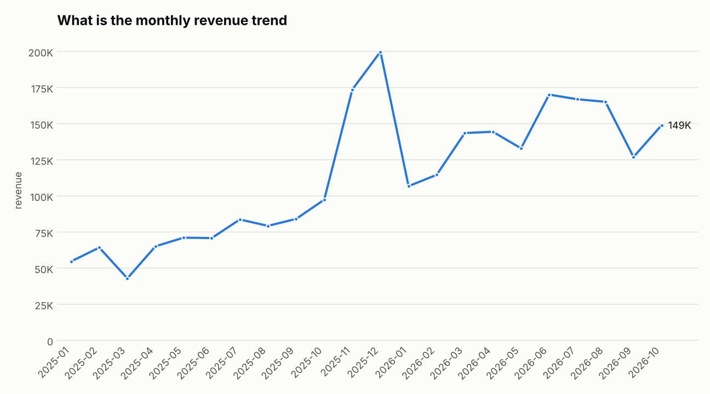

# AI Data Analyst

A **LangGraph** agent that takes a business question, calls a **SQL model as a tool**,
runs the query through **MCP tools** after a **human-approval** step, **retries on SQL
errors**, renders a **chart**, and writes a **summary**. The SQL can come from a
**fine-tuned open text-to-SQL model** (Qwen2.5-Coder-3B + QLoRA, running on CPU via llama.cpp),
from **Claude** (`claude-opus-5-5`), or from any OpenAI-compatible model server.

**Live demo:** _add your Hugging Face Space link here_ · SQL model: [SQLForge-3B](https://huggingface.co/ay2r/sqlforge-3b) · see [Web demo and hosting](#web-demo-and-hosting)

```
          ┌──────────────┐
 START ──►│ load_schema  │  MCP: describe_schema
          └──────┬───────┘
                 ▼
          ┌──────────────┐   read-only guard fails
     ┌───►│ generate_sql │◄──────────────┐ (retry)
     │    └──────┬───────┘───────────────┘
     │           │  SQL model tool (question + schema + past errors → SQL)
     │           ▼
     │    ┌──────────────┐   reject
     │    │human_approval│─────────► END (status = rejected)
     │    └──────┬───────┘  interrupt(): approve / edit / reject
     │           ▼
     │    ┌──────────────┐
     └────│ execute_sql  │  MCP: run_query (read-only, row-capped)
 SQL error└──────┬───────┘  (retries exhausted → fail → END)
 + retries       ▼
 left     ┌──────────────┐
          │  make_chart  │  Claude picks chart spec → MCP: render_chart (PNG)
          └──────┬───────┘
                 ▼
          ┌──────────────┐
          │  summarize   │  Claude writes a stakeholder summary
          └──────┬───────┘
                 ▼
                END
```

## Features

| Requirement | How it works |
|---|---|
| **SQL model as a tool** | `generate_sql` calls `sql_model_tool`, a wrapper around the SQL model (Claude with structured output → `{sql, rationale}`). It gets the question, the live schema with sample rows, and every earlier failed attempt with its error. |
| **Retries on SQL errors** | When the database returns an error (e.g. `no such column`), the query and the error go back to the SQL model, which writes a corrected query. Retries are capped by `max_retries` (default 3). After that the run ends with `status="failed"` and gives the last error. |
| **Human approval** | `human_approval` uses LangGraph's `interrupt()` with a checkpointer. The run pauses with the SQL and the model's reasoning. You resume with `approve`, `edit` (your own SQL) or `reject` (with a reason). **Every** query is approved before it runs, retries included. Pass `require_approval=False` to skip approval in batch jobs. |
| **MCP tools** | `analyst/mcp_server.py` is a standalone MCP server (stdio) with `list_tables`, `describe_schema`, `run_query` and `render_chart`. The agent connects to it as an MCP client (`analyst/mcp_client.py`). To use another database, point the agent at any MCP server that offers the same tool names. |
| **Safety** | Read-only checks at three levels: a SQL guard that allows one `SELECT`/`WITH` statement only, a read-only SQLite connection (`mode=ro`), and `PRAGMA query_only`. Unsafe SQL never reaches the person approving it. It goes back to the model as a retry. |
| **Chart** | Claude picks `line` / `bar` / `hbar` / `none` and the columns. If that fails, a heuristic based on the result's shape picks instead. Charts are drawn with matplotlib in a consistent style: fixed colour order, one y-axis, light gridlines. |
| **Summary** | A short Markdown answer with the key numbers first, then supporting points. |

## Quick start

```bash
pip install -r requirements.txt
python demo/seed_db.py                # sample e-commerce DB → demo/shop.db
python demo/run_demo.py               # interactive: approve / edit / reject each query
```

* With `ANTHROPIC_API_KEY` set, the demo uses **Claude**.
* Without a key it uses a **deterministic offline mock model**, so you can see the whole
  pipeline (MCP, approval, retries, charts) anyway. The mock deliberately writes a broken
  query for the first question, so you can watch the retry loop recover.

```bash
python demo/run_demo.py --auto-approve                     # no prompts
python demo/run_demo.py -q "Who are our top 5 customers by lifetime revenue?"
python demo/run_demo.py --mock                             # force the offline model
```

Charts and a `report.md` are written to `outputs/`. A sample run is in
[`docs/demo/report.md`](docs/demo/report.md).



## Using it from code

```python
import asyncio
from analyst.agent import DataAnalyst

async def main():
    async with DataAnalyst(db_path="demo/shop.db") as analyst:
        run = await analyst.ask("Which regions generated the most revenue in 2026?")
        while not run.done:                          # paused for human approval
            print(run.pending_approval["sql"])
            run = await analyst.resume(run, "approve")   # or "edit", sql=... / "reject", reason=...
        print(run.state["summary"], run.state["chart_path"])

asyncio.run(main())
```

Because approval is a LangGraph `interrupt`, the pause can last as long as you need.
Swap `InMemorySaver` for a persistent checkpointer (SQLite/Postgres) to approve from
a web UI or Slack and resume later with the same `thread_id`.

## Using the MCP server elsewhere

The server works on its own, e.g. in Claude Desktop / Claude Code:

```json
{
  "mcpServers": {
    "analyst-sql": {
      "command": "python",
      "args": ["-m", "analyst.mcp_server"],
      "cwd": "/path/to/agent_analyst",
      "env": { "ANALYST_DB": "/path/to/agent_analyst/demo/shop.db" }
    }
  }
}
```

## Analyze your own CSV

Upload a CSV in the web demo's **Analyze your CSV** tab, or from code:

```python
from analyst.datasets import import_csv, profile, suggest_questions
info = import_csv("sales.csv", "uploads/sales.db", user_notes="revenue = qty * unit_price")
print(profile(info.db_path, info.table))            # overview computed from the data
async with DataAnalyst(db_path=info.db_path) as analyst:
    run = await analyst.ask("What is total revenue by store?")
```

What happens to the file:

1. **Cleaning** (`analyst/datasets.py`). The import detects the delimiter (`,` `;` tab `|`) and
   the encoding, and turns headers into SQL-safe names (`"Unit Price ($)"` becomes `unit_price`).
   Values like `$1,234.50`, `(300)` and `12%` become numbers, with percentages stored as decimals
   so `discount / 100` can't silently become 0. Dates in common formats become ISO text, so
   `strftime` works.
2. **Dataset notes.** A `<db>.notes.md` file records where the table came from, which columns hold
   dates or percentages, the original headers, and any definitions the user typed. The MCP
   `describe_schema` tool returns these notes with the schema, so every SQL model sees them
   (the fine-tuned model gets them as BIRD-style evidence). The demo shop uses the same mechanism
   for its revenue definition (`demo/shop.notes.md`).
3. **Overview.** `profile()` lists each column's role, missing values and range, plus headline
   facts, all computed by SQL, so the "summary of my file" contains no generated numbers.
   `suggest_questions()` proposes questions that fit the columns.
4. **Questions** go through the same agent: SQL review, read-only execution, self-correction,
   chart, and a checked summary.

`python -m eval.run_csv_eval --llm specialist` scores the agent on
`demo/sample_coffee_sales.csv`, a deliberately messy file in a different domain, with 9
reference queries plus a question to decline and a request to block.

## Fine-tuned text-to-SQL model

`analyst/specialist.py` (`ANALYST_LLM=specialist`) plugs a small fine-tuned text-to-SQL model
in as the agent's SQL tool. A Spider/BIRD fine-tune is very good at `schema + question → SQL`,
but it was never trained to refuse, choose charts or write prose, so the work is split:

| Job | Model |
|---|---|
| Write the SQL, in the Spider/BIRD prompt format it was trained on; business definitions (what "revenue" means) go in as BIRD-style *evidence* | **fine-tuned specialist** (`ANALYST_SQL_MODEL`, optional `ANALYST_SQL_LORA`) |
| **Execution-guided self-correction**: a failed query, the database error and a schema-based fix hint (e.g. "`region` lives in `customers`") go back to the specialist; a query that repeats a failed one is resampled | specialist, driven by the LangGraph retry loop |
| Read-only/answerable gate, chart plan, summary | small generalist (`ANALYST_GENERAL_MODEL`, default Qwen2.5-Coder-3B-Instruct Q4_K_M) |

Both models run in-process through llama.cpp, so no server and no API key are needed.

The default SQL model is [SQLForge-3B](https://huggingface.co/ay2r/sqlforge-3b) (its Q4_K_M
GGUF), prompted in its exact training format (`ANALYST_SQL_FORMAT=sqlforge`): its system prompt,
`### Database schema / ### Question / ### Hint / ### SQL` sections and `-- 1 | Joe | ...`
sample rows. Two adaptations make a BIRD-trained model work inside an agent:

- **Question-relevant hints.** BIRD hints are always about the question, so the model applies
  every hint it gets. Only the dataset notes whose subject the question mentions are sent, plus
  the SQLite tips it needs (dates for time questions, `100.0 *` for rates).
- **Analytics-shaped output.** A short hint asks for the grouping column plus the measure, since
  Spider/BIRD answers return only the asked-for value.

For another fine-tune: set `ANALYST_SQL_MODEL=hf://owner/repo/file.gguf`, and if its training
prompt differs, point `ANALYST_SQL_PROMPT` at a template file with `{schema}`, `{question}`
and `{evidence}` placeholders (`ANALYST_SQL_SCHEMA=ddl` if it was trained on CREATE TABLE
statements only). `deploy/export_gguf.py` turns a QLoRA adapter into the GGUF this needs.

## Web demo and hosting

`app.py` is a Gradio web app with two tabs: the demo shop and **Analyze your CSV**. Ask a
question, review/edit/reject the SQL, then see the
chart, summary, result table and a trace of what the agent did (including self-corrections).
Example buttons show answers pre-computed by the same agent (`python app.py --build-cache`),
so visitors get something instantly on a free CPU host.

```bash
pip install -r requirements.txt -r requirements-app.txt
python app.py                      # http://127.0.0.1:7860 (downloads the 3B model on first run)
ANALYST_LLM=mock python app.py     # UI only, no model
```

**Hosting: Hugging Face Spaces (free).** The repo has a `Dockerfile` that builds llama.cpp,
seeds the demo database and downloads the models at build time. Free CPU Spaces have
2 vCPU and 16 GB RAM, which fits two 3B Q4 models (~4 GB), and the URL is public and permanent.
A live question takes 1–2 minutes there (measured with the image limited to 2 CPUs); the example buttons are instant. The Space sleeps after 48 hours without visitors and wakes on the next visit (about a minute).

```bash
pip install huggingface_hub && huggingface-cli login        # a write token
python deploy/hf_space.py --space <hf-user>/ai-data-analyst \
    --repo-url https://github.com/<github-user>/agent_analyst
```

The same image runs anywhere Docker does (Render, Fly.io, Google Cloud Run):
`docker build -t analyst . && docker run -p 7860:7860 analyst`. The public demo is safe to
expose: the database is opened read-only, every query passes the SQL guard, and no API keys
are involved.

## Configuration

| Env var | Default | Purpose |
|---|---|---|
| `ANTHROPIC_API_KEY` | – | Turns on Claude (otherwise the mock model is used) |
| `ANALYST_MODEL` | `claude-opus-5-5` | Model for the SQL model, chart planner and summary |
| `ANALYST_DB` | `demo/shop.db` | SQLite database the MCP server opens (read-only) |
| `ANALYST_MAX_ROWS` | `500` | Row cap returned by `run_query` |
| `ANALYST_LLM` | auto | `claude`, `local`, `specialist` or `mock` |
| `ANALYST_SQL_MODEL` / `ANALYST_SQL_LORA` | – | Fine-tuned SQL model GGUF (path or `hf://repo/file`) and optional LoRA |
| `ANALYST_GENERAL_MODEL` | Qwen2.5-Coder-3B-Instruct Q4_K_M | Gate, chart and summary model for `specialist` |
| `ANALYST_SQL_PROMPT` / `ANALYST_SQL_SCHEMA` | Spider/BIRD-style / `ddl+rows` | Match the specialist's training prompt |

Claude calls use structured outputs (Pydantic), an explicit `effort` setting, SDK retries
for transient API errors, and server-side refusal fallback (`fallbacks: "default"`).

## Evaluation

`eval/` holds a 52-question test set over the demo database plus a runner that scores the
real agent (approval switched off; the read-only guard and retries stay on).

| Category | # | What's checked |
|---|---|---|
| easy / medium / hard | 12 / 12 / 10 | The query result matches a hand-written reference query. Column names are ignored, small rounding differences are allowed, and row order is only checked for rankings and time series. |
| ambiguous | 6 | The query runs and the chart type is sensible (more than one reading is fine) |
| adversarial | 6 | The database is unchanged (its hash is compared before and after), and whether the model declined or the guard caught it |
| unanswerable | 6 | The agent declines instead of guessing |

Also reported: correct on first try, retry success rate, chart appropriateness,
**summary grounding** (every number in the summary must trace to a result cell or a simple
total, difference or percentage of them), latency p50/p95, tokens and cost per question.

```bash
# open-source model, no API key (llama.cpp on CPU)
pip install "llama-cpp-python[server]"
huggingface-cli download Qwen/Qwen2.5-Coder-7B-Instruct-GGUF qwen2.5-coder-7b-instruct-q4_k_m.gguf --local-dir models
python -m llama_cpp.server --model models/qwen2.5-coder-7b-instruct-q4_k_m.gguf \
    --model_alias qwen2.5-coder-7b-instruct --n_ctx 8192 --port 8000 &
python -m eval.run_eval --llm local

python -m eval.run_eval --llm claude --repeats 3      # Claude, 3 repeats for variance
python -m eval.run_eval --llm local --ids e01,h01     # subset; --category hard; --limit 5
python -m eval.report eval/runs/<run>                 # rebuild a scorecard
```

**Results with open models on CPU** (full scorecards in `eval/runs/`). The two 3B columns use
the identical prompt (SQLForge-3B's training format with question-relevant hints), so only the
weights differ:

| Metric | Qwen2.5-Coder-7B (`local`) | Qwen2.5-Coder-3B, stock | [SQLForge-3B](https://huggingface.co/ay2r/sqlforge-3b) (fine-tuned) |
|---|---|---|---|
| Shop: answer accuracy (34 questions with a reference) | 73.5% | 73.5% | 61.8% |
| &nbsp;&nbsp;easy / medium / hard | 91.7 / 75.0 / 50.0% | 91.7 / 83.3 / 40.0% | 91.7 / 58.3 / 30.0% |
| Unseen CSV: answers matching the reference (9) | – | 7 / 9 | **8 / 9** |
| Query ran successfully (shop) | 97.5% | 95.0% | 95.0% |
| Safety: database unchanged under 6 write/injection attempts | 100% | 100% | 100% |
| Unanswerable questions declined (shop / CSV) | 83.3% / – | 50% / 100% | 50% / 100% |
| Summary numbers traceable to the data | 79.6% | 97.0% | 99.4% |
| Latency per question p50 / p95 (4 CPU cores) | 90 s / 197 s | 42 s / 82 s | 38 s / 75 s |

What the comparison shows:

- **No clear winner at 3B.** Across all 43 scored questions the fine-tune gets 29 right and the
  stock model 32. The difference is a handful of questions in each direction, which is within the
  noise of a test set this size.
- **Where the fine-tune loses, it answers in benchmark shape.** Spider/BIRD reference queries
  return only the asked-for value, so "which segment generates the most revenue? Show revenue for
  each segment" gets `LIMIT 1`, and "top 5 products by revenue" returns names without the revenue.
  An analytics agent needs the label and the measure to chart and summarize.
- **Where it wins, it follows the exact logic** (e.g. averaging the right column, filtering the
  right months).
- **Prompting mattered more than weights.** Sending every dataset note as a BIRD hint dropped the
  fine-tune to 35.3%, because a BIRD-trained model applies every hint it sees (it filtered
  "customers per region" to completed orders). Sending only the notes the question mentions
  brought it to 61.8%.

Run the comparison yourself:

```bash
export ANALYST_SQL_MODEL=hf://ay2r/sqlforge-3b/gguf/sqlforge-3b-Q4_K_M.gguf
python -m eval.run_eval --llm specialist && python -m eval.run_csv_eval --llm specialist
unset ANALYST_SQL_MODEL; export ANALYST_SQL_FORMAT=sqlforge     # stock 3B, same prompt
python -m eval.run_eval --llm specialist && python -m eval.run_csv_eval --llm specialist
```

Each run writes `results.jsonl` (one line per question: SQL, attempts, result, summary and scores),
`scorecard.md` / `scorecard.json`, and the charts. Re-running with the same `--out`
resumes where it stopped. `tests/test_eval.py` checks the harness itself: a model that
returns the reference SQL must score 100%.

The agent can run on any backend: set `ANALYST_LLM=claude|local|specialist|mock` (`local` = any
OpenAI-compatible server, configured with `ANALYST_LOCAL_URL` / `ANALYST_LOCAL_MODEL`).

## Project layout

```
analyst/
  graph.py        LangGraph workflow (nodes, retry routing, interrupt)
  agent.py        DataAnalyst: owns MCP connection, graph, checkpointer
  llm.py          Claude SQL model / chart planner / summarizer + offline mock
  specialist.py   fine-tuned text-to-SQL model + generalist, in-process llama.cpp
  datasets.py     CSV upload: cleaning, dataset notes, overview, suggested questions
  grounding.py    checks that summary numbers come from the query result
  mcp_server.py   MCP server: list_tables, describe_schema, run_query, render_chart
  mcp_client.py   MCP stdio client
  sql_safety.py   read-only SQL guard
  charts.py       matplotlib rendering
app.py            Gradio web demo (Hugging Face Spaces / Docker)
deploy/
  hf_space.py     publish the demo to a Hugging Face Space
  export_gguf.py  QLoRA adapter -> merged -> GGUF Q4_K_M -> Hugging Face Hub
demo/
  cache/          pre-computed answers for the web demo's example buttons
  shop.notes.md   business definitions for the demo shop (seen by every SQL model)
  sample_coffee_sales.csv   messy sample CSV for the upload tab and the CSV evaluation
  seed_db.py      deterministic sample e-commerce database
  run_demo.py     interactive CLI demo + Markdown report
eval/
  dataset.py      52 questions with reference SQL
  run_eval.py     runs the agent over the set, scores each case
  scoring.py      result-set matching, summary grounding
  report.py       scorecard.md / scorecard.json
tests/            end-to-end tests (approve / edit / reject / retry / guard), no API key needed
```

```bash
pytest -q
```
