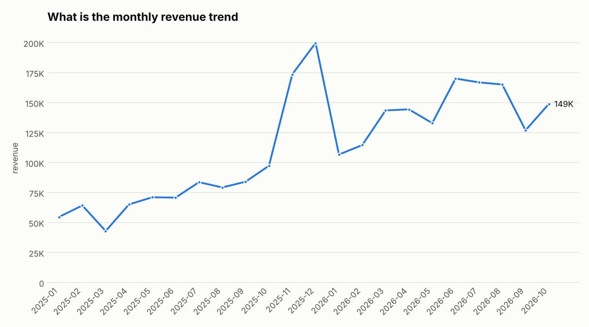
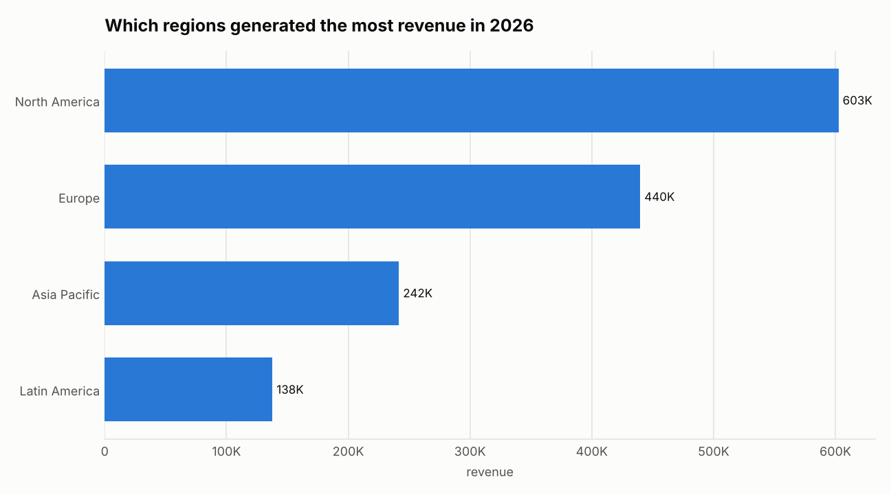
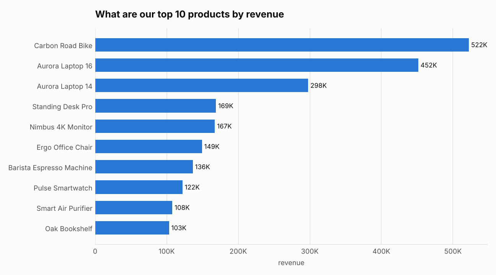
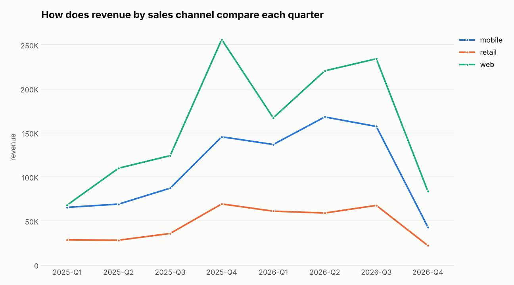
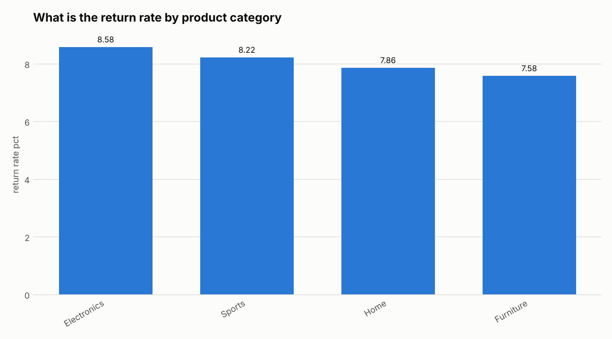

# AI Data Analyst — demo report
_Generated 2026-11-20 05:24 · model: mock (offline)_

## What is the monthly revenue trend?

**Status:** done · **SQL attempts:** 2



Revenue moved from 54,814.70 in 2025-01 to 149,096.45 in 2026-10 (+172.0%).

- Peak: **2025-12** at 199,944.75
- Total over 22 periods: 2,510,261.20
- Average per period: 114,102.78

<details><summary>SQL</summary>

```sql
SELECT strftime('%Y-%m', o.order_date) AS month, ROUND(SUM(oi.quantity * oi.unit_price * (1 - oi.discount)), 2) AS revenue
FROM orders o JOIN order_items oi ON oi.order_id = o.order_id
WHERE o.status = 'completed' GROUP BY month ORDER BY month
```
</details>

<details><summary>Failed attempts (auto-retried)</summary>

```sql
SELECT strftime('%Y-%m', o.order_date) AS month, ROUND(SUM(o.total_amount), 2) AS revenue
FROM orders o WHERE o.status = 'completed' GROUP BY month ORDER BY month
```
> OperationalError: no such column: o.total_amount

</details>

## Which regions generated the most revenue in 2026?

**Status:** done · **SQL attempts:** 1



**North America** is highest on revenue at 602,573.40 (42.4% of the total).

- Lowest: Latin America at 137,768.65
- Gap between highest and lowest: 464,804.75
- 4 groups compared

<details><summary>SQL</summary>

```sql
SELECT c.region, ROUND(SUM(oi.quantity * oi.unit_price * (1 - oi.discount)), 2) AS revenue, COUNT(DISTINCT o.order_id) AS orders
FROM orders o JOIN customers c ON c.customer_id = o.customer_id
JOIN order_items oi ON oi.order_id = o.order_id
WHERE o.status = 'completed' AND o.order_date >= '2026-01-01'
GROUP BY c.region ORDER BY revenue DESC
```
</details>

## What are our top 10 products by revenue?

**Status:** done · **SQL attempts:** 1



**Carbon Road Bike** is highest on revenue at 522,152.55 (23.5% of the total).

- Lowest: Oak Bookshelf at 103,198.85
- Gap between highest and lowest: 418,953.70
- 10 groups compared

<details><summary>SQL</summary>

```sql
SELECT p.name AS product, ROUND(SUM(oi.quantity * oi.unit_price * (1 - oi.discount)), 2) AS revenue
FROM order_items oi JOIN orders o ON o.order_id = oi.order_id
JOIN products p ON p.product_id = oi.product_id
WHERE o.status = 'completed' GROUP BY p.name ORDER BY revenue DESC LIMIT 10
```
</details>

## How does revenue by sales channel compare each quarter?

**Status:** done · **SQL attempts:** 1



**web** leads on revenue with 1,264,393.20 across the period.

- **web**: 1,264,393.20 (50.4% of total)
- **mobile**: 873,400.85 (34.8% of total)
- **retail**: 372,467.15 (14.8% of total)

<details><summary>SQL</summary>

```sql
SELECT strftime('%Y-Q', o.order_date) || ((CAST(strftime('%m', o.order_date) AS INTEGER) + 2) / 3) AS quarter,
       o.channel, ROUND(SUM(oi.quantity * oi.unit_price * (1 - oi.discount)), 2) AS revenue
FROM orders o JOIN order_items oi ON oi.order_id = o.order_id
WHERE o.status = 'completed' GROUP BY quarter, o.channel ORDER BY quarter, o.channel
```
</details>

## What is the return rate by product category?

**Status:** done · **SQL attempts:** 1



**Electronics** is highest on return rate pct at 8.58.

- Lowest: Furniture at 7.58
- Gap between highest and lowest: 1.00
- 4 groups compared

<details><summary>SQL</summary>

```sql
SELECT p.category,
       ROUND(100.0 * SUM(CASE WHEN o.status = 'returned' THEN 1 ELSE 0 END) / COUNT(*), 2) AS return_rate_pct
FROM orders o JOIN order_items oi ON oi.order_id = o.order_id
JOIN products p ON p.product_id = oi.product_id
GROUP BY p.category ORDER BY return_rate_pct DESC
```
</details>
